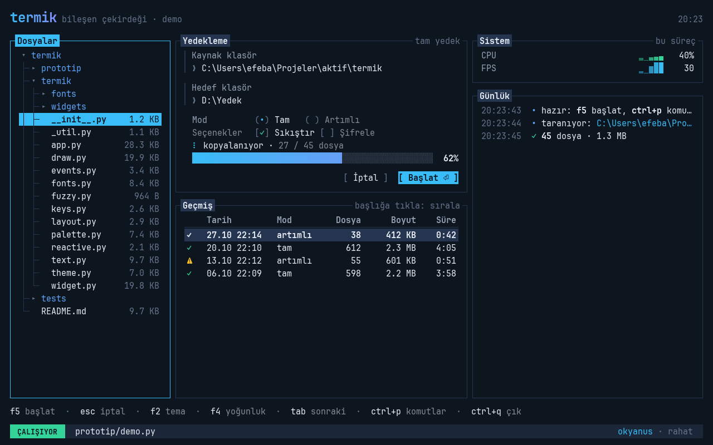
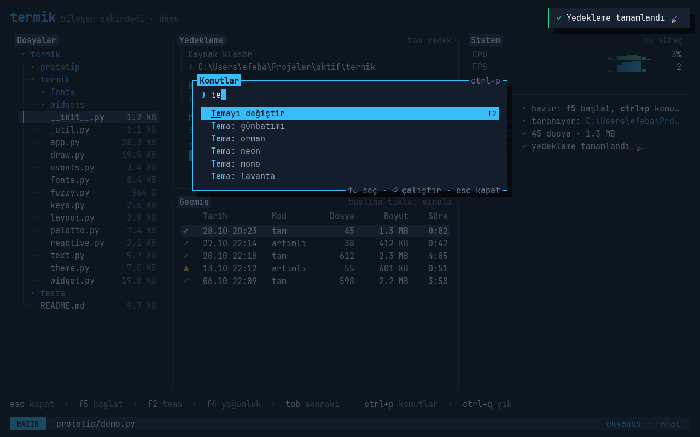
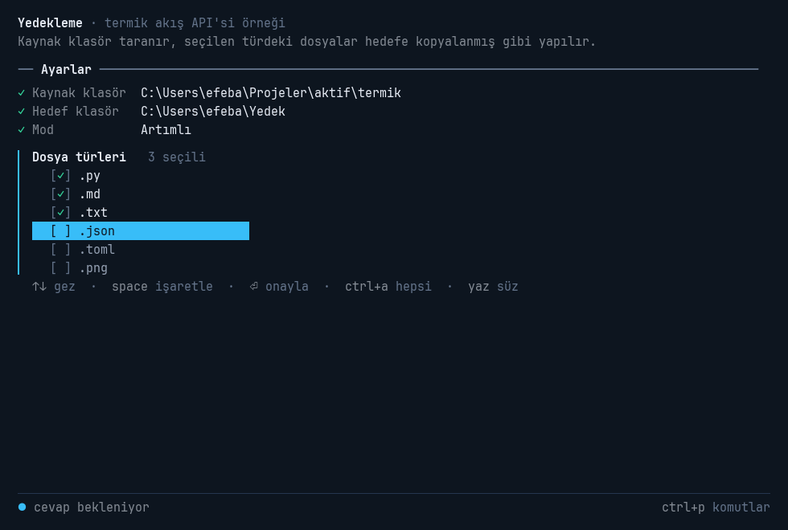
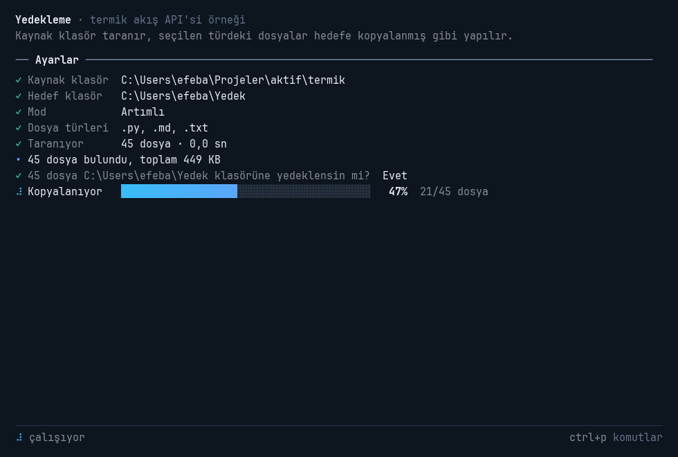
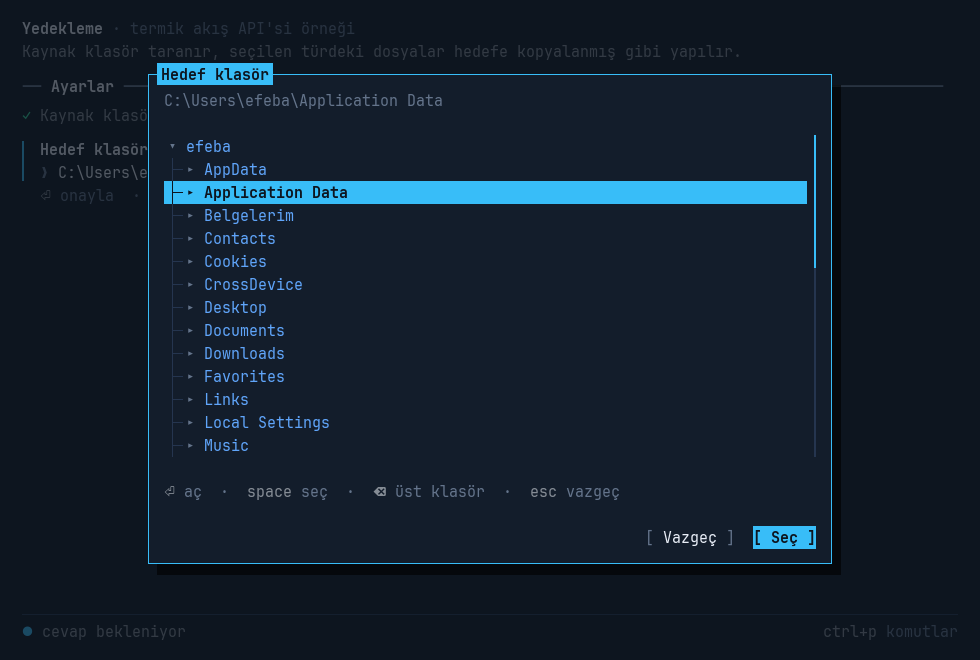
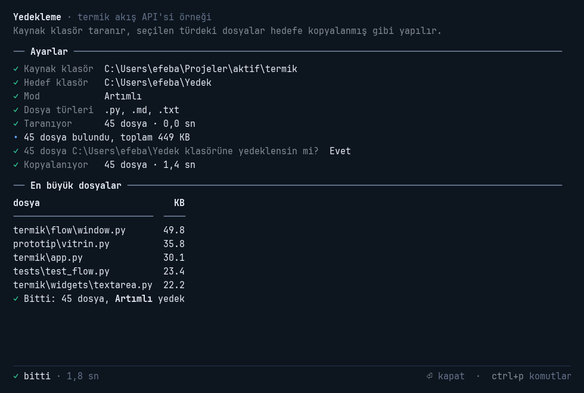

# termik

CLI'ın görünüşü ve hissi, GUI'ın kullanım rahatlığıyla. pygame-ce üzerinde çalışan bir Python
arayüz kütüphanesi.



> **Durum: v0.5.0.** İki katman da hazır ve paket `pip` ile kuruluyor. Akış API'si (`ask`,
> `choose`, `confirm`, `track`…) script'lere birkaç satırla pencere verir; pencere açılamazsa aynı
> script terminalde çalışır. Görünüm tercihleri bir ayar dosyasında tutulur.
> Bileşen katmanında çekirdek (ağaç, flex yerleşim, odak, olay yönlendirme, `@action`, reaktif
> öznitelikler, asyncio + thread işçileri), Ctrl+P komut paleti, modal diyaloglar ve 18 bileşen var;
> üç sütunlu bir demo uygulama örnek.



## Kurulum

```bash
pip install termik
```

Python 3.11 ya da daha yenisi gerekir; pygame-ce kendiliğinden kurulur. Kurulunca `termik` komutu
gelir:

```bash
termik akis       # akış API'si örneği: script'e pencere
termik demo       # bileşen katmanı demosu: çok panelli uygulama
termik ayarlar    # görünüm tercihlerini seç ve kaydet
```

pygame-ce kurulamayan bir ortamda (bazı sunucular) akış API'si terminalde çalışmayı sürdürür.

## Hızlı başlangıç

Script'ler için akış API'si: `input()` ve `print()` kadar kısa.

```python
import termik

ad = termik.ask("Adın?")
mod = termik.choose("Mod", ["Tam", "Artımlı"])
if termik.confirm(f"{mod} yedek alınsın mı?"):
    for dosya in termik.track(dosyalar, "Kopyalanıyor", unit="dosya"):
        kopyala(dosya)
termik.ok(f"Bitti, [bold]{ad}[/]!")
```

Çok panelli uygulamalar için bileşen katmanı:

```python
import termik as ui

class Merhaba(ui.App):
    def compose(self):
        with ui.Panel(title="Selam"):
            yield ui.Input(label="Adın", id="ad")
            with ui.Row():
                yield ui.Spacer()
                yield ui.Button("Selamla", action="greet", variant="primary")
        yield ui.KeyBar()   # f5 selamla · tab sonraki · ctrl+q çık

    @ui.action("Selamla", key="f5", hint="selamla")
    def greet(self):
        ad = self.query_one("#ad", ui.Input).value
        self.notify(f"Merhaba {ui.escape(ad)}!", "ok")

Merhaba().run()
```

## Akış API'si

Pencere bir terminal oturumu gibi alt alta akan bir dökümdür. Cevaplanan soru tek satırlık özete
döner, özetlerin cevapları hizalı bir sütun oluşturur. Etkin soru hep en altta ve odaktadır.



| Fonksiyon | İş |
|---|---|
| `print(*nesneler, sep=, end=, markup=True)` | `print()` gibi; yazılar markup'tır, diğer nesneler olduğu gibi yazılır |
| `ok`, `info`, `warn`, `error` | `✓ • ⚠ ✗` simgeli satır |
| `rule("Başlık")` | `── Başlık ──────` ayraç |
| `table(satırlar, headers=None)` | Hizalı tablo; sözlük listesinde başlıklar anahtarlardan gelir, sayılar sağa yaslanır |
| `ask(soru, default=, type=, validate=, password=)` | Yazı sorar. `type=int` çevirir, `validate` denetler; hatalı girişte soru hatayla tekrarlanır. `default` alanı dolu ve seçili getirir, türü de ondan çıkar (`default=8080` → `int`) |
| `ask_path(soru, kind="dir", must_exist=True)` | `Path` döndürür. Tab tamamlar (birden çok aday varsa aralarında döner), Ctrl+O klasör ağacını açar; `~`, ortam değişkenleri ve kopyalanan yolların tırnakları işlenir |
| `choose(soru, seçenekler, default=)` | Liste, `(etiket, değer)` çiftleri ya da sözlük alır, değeri döndürür; yazdıkça bulanık süzülür (`artim` → "Artımlı") |
| `choose_many(soru, seçenekler, default=, min=, max=)` | Çoklu seçim: space işaretler, ctrl+a görünenlerin hepsini işaretler ya da kaldırır |
| `confirm(soru, default=True, yes=, no=)` | `bool` döndürür; ←/→ ve Enter, ya da baş harfler (`e`/`h`) |
| `track(yinelenebilir, etiket, total=, unit=)` | Döngüyü ilerleme çubuğuyla sarar; `break` ile biterse satır "durduruldu" olur |
| `progress(etiket, total=, unit=)` | Elle ilerletilen çubuk: `with … as p: p.advance(n)`; `unit="B"` boyutları KB/MB gösterir |
| `spinner(etiket)` | `with` bloğu süresince dönen işaret ve geçen süre; `sp.update("12 MB alındı")` açıklama ekler |
| `setup(title=, theme=, look=, density=, keep_open=, mode=, …)` | İlk çağrıdan önce: pencere başlığı, görünüm ve biçim belirteçleri (bileşen katmanındakilerle aynı) |



**Nasıl çalışır:**

- Pencere ilk çağrıda **ayrı bir thread'de** açılır; script kendi thread'inde sürer. Script uzun
  bir iş yaparken (indirme, kopyalama, `time.sleep`) pencere donmaz: spinner döner, döküm kayar.
  `track` döngünün her adımında mesaj göndermez, pencere sayacı kendi hızında okur.
- **Pencereyi kapatmak script'te `KeyboardInterrupt` doğurur**, terminalde Ctrl+C'ye basmak gibi.
  Script o an kendi işindeyse (ör. `time.sleep(30)`) de kesilir.
- **Script bitince pencere açık kalır**, durum satırı "bitti" der; ⏎ ya da esc kapatır.
  `setup(keep_open=False)` pencereyi kendiliğinden kapatır.
- **Yakalanmayan hata pencerede gösterilir** ve pencere her durumda açık kalır. Bu, `pythonw` ile
  çift tıklanıp konsolsuz açılan script'ler için önemli.
- Pencerede ctrl+p komut paleti (tema, yoğunluk), ctrl+shift+c dökümü panoya kopyalar. Dökümde
  en çok 2000 çıktı satırı tutulur.



**Terminal kipi.** Pencere açılamıyorsa (pygame-ce kurulu değil, Linux'ta görüntü sunucusu yok)
aynı script terminalde çalışır. macOS pencereyi ana thread'de istediği için orada da şimdilik terminal
kipi kullanılır. `TERMIK_MODE=terminal` ya da `TERMIK_MODE=window` kipi zorlar. Etkileşimli bir
terminalde renkler gelir, ilerleme satırları yerinde güncellenir, cevaplanan soru özete döner.
Boruya ya da dosyaya giden çıktı düz yazıdır. Seçimler numara ya da yazıyla yapılır; çoklu seçimde
`1,3`, `2-4` ve `*` geçerlidir. Girdi kapalıysa (stdin yok) soru `EOFError` verir; cevapsız soru
sessizce varsayılana düşmez.

```
termik terminal kipi · deneme
── Sorular ──────────────────────────────────
✓ Port  8080
✓ Mod   Artımlı
✓ Uzantılar  .py, .txt
✓ Devam edilsin mi?  Evet
── İş ───────────────────────────────────────
✓ Bağlanılıyor       el sıkışma · 1,8 sn
✓ Kopyalanıyor       60 dosya · 2,4 sn
```

Modül fonksiyonları ilk kullanımda kurulan varsayılan oturuma gider. Ayrı bir oturum
`termik.flow.Session(...)` ile kurulur ve aynı metotları taşır; testlerde
`Session(mode="window", headless=True)` pencereyi görünmez açar.



## Temel kavramlar

- **Bileşen ağacı.** `compose()` içinde `yield` ile bileşen, `with ui.Row():` ile iç içe kapsayıcı
  açılır. `query("#id")`, `query_one(".sınıf", Tür)` ile bulunur; `mount()` / `remove()` ile çalışırken
  değişir.
- **Yerleşim (flex).** `Row` yan yana, `Column` ve varsayılan dizim alt alta. Boyutlar CLI biriminde:
  `width=30` 30 karakter, `height=2` 2 satır; ayrıca `"12px"`, `"40%"`, `"2fr"`, `"auto"`. `gap`,
  `padding`, `min_width`… da aynı birimlerle. Kapsayıcılar içlerinde büyüyen bir bileşen (ör. `Log`)
  varsa büyür, yoksa içerikleri kadar yer kaplar. `Spacer` kalan yeri doldurur.
- **Odak ve klavye.** Tab/Shift+Tab odaklanabilir bileşenler arasında gezer, tıklamak odaklar; içinde
  odak olan `Panel`'in çerçevesi yanar. Tuş önce odaktaki bileşene gider (`on_key`), sonra ebeveynlere
  kabarcıklanır. Yazı alanındayken harf tuşları kısayol tetiklemez; Türkçe klavyedeki AltGr (`@`)
  kısayol sanılmaz.
- **`@action`.** Bir metodu komut yapar: tuşa bağlanır, `KeyBar`'da görünür (tıklanabilir), butona
  `action="ad"` ile verilir. Odaktaki bileşenden uygulamaya kadar en içteki kazanır;
  `priority=True` olanlar (ör. `ctrl+q`) her yerde önce gelir.
- **Komut paleti.** `ctrl+p` bağlamdaki bütün `@action`'ları (`palette=False` olanlar hariç) ve
  `App.get_commands()`'ın verdiklerini listeler; varsayılan olarak tema ve yoğunluk seçimi de oradadır.
  Bulanık arama Türkçe harfleri gevşek eşler: `baslat` yazınca "Başlat" bulunur.
- **Reaktif öznitelikler.** `progress = ui.reactive(0.0)`; değer değişince bileşen kendiliğinden
  yeniden çizilir, varsa `watch_progress(old, new)` çağrılır. Boyutu etkileyenler için `layout=True`.
- **Mesajlar.** Bileşenler mesaj gönderir ve bunlar yukarı kabarcıklanır: `Button.Pressed` →
  `on_button_pressed`, `Input.Submitted` → `on_input_submitted`. `event.stop()` yayılmayı durdurur.
- **async ve işçiler.** İşleyiciler ve eylemler `async def` olabilir; ağ çağrıları pencereyi dondurmadan
  `await` edilir. Bloklayan işler `await self.run_worker(fn, ...)` ile ayrı thread'de koşar;
  başka thread'den arayüz `call_from_thread()` ile güncellenir. `set_interval()` / `set_timer()`
  zamanlayıcıları bileşen kaldırılınca durur.
- **Diyaloglar.** `await self.confirm("İptal edilsin mi?")`, `await self.alert("Bitti")`,
  `await self.prompt("Yeni ad", value="rapor.md")`. Kendi diyaloğun için `Dialog(başlık, içerik,
  buttons=[("Vazgeç", False), ("Sil", True)])` ve `await self.push_screen_wait(diyalog)`; ekranlar
  `dismiss(sonuç)` ile kapanır, odak önceki yerine döner. Diyalog açıkken arka plandaki işler sürer.
- **Bildirim ve hatalar.** `notify("…", "ok")` sağ üstte kısa süreli bildirim gösterir. İşleyicideki
  bir hata uygulamayı düşürmez: konsola iz, ekrana bildirim olarak düşer.
- **Çizim.** Ekran yalnızca bir şey değişince (ya da animasyon varken) çizilir; boşta döngü yalnızca
  olayları yoklar.

## Bileşenler

| Bileşen | İş |
|---|---|
| `Static`, `Label` | Markup yazı; `Static` genişliğe göre kaydırır, `Label` `…` ile kısalır |
| `Button` | `[ Tamam ]`; `action=`, `on_press=`, `variant="primary"`; Enter/Space/tık |
| `Input` | Tek satır yazı: blok imleç, seçim, pano, kelime kelime gezinme; `label=` ile etiketli alan |
| `TextArea` | Çok satırlı yazı: kelime sınırından kaydırma, seçim, pano, geri al/yinele, girinti koruma, satır numaraları, yazdıkça uzama (`max_rows`), gönderme tuşu (`submit_key="ctrl+enter"`) |
| `Checkbox`, `RadioSet` | `[✓]` ve `(•)`; tık, Space, ←/→ |
| `ProgressBar` | Temadaki çubuk biçimiyle ilerleme + yüzde |
| `Log` | Kayan kayıt: `info/ok/warn/error`, saat damgası, tekerlek ve tuşlarla gezinme, canlı takip |
| `Tree`, `DirectoryTree` | Açılır kapanır ağaç: `├─ └─` dalları, ←/→ aç-kapa, tembel yükleme (`load_children`); klasör ağacı alt klasörleri ilk açılışta okur |
| `Table` | Sabit başlıklı tablo: satır imleci, başlığa tıklayınca doğal sıralama, çift tık/Enter ile seçim |
| `Sparkline` | Akan değerler için mini grafik; etiket ve son değer |
| `Panel` | Başlıklı çerçeve; içindekileri alt alta dizer; `floating=True` yüzen kutular için |
| `ScrollView` | Kaydırılabilir kapsayıcı: tekerlek, PgUp/PgDn, sürüklenebilir çubuk; odaktaki bileşeni görünür alana getirir |
| `Dialog`, `PromptDialog` | Modal kutular; çoğunlukla `App.confirm/alert/prompt` ile kullanılır |
| `Header`, `KeyBar`, `StatusBar` | Logo ve saat; geçerli kısayollar (tıklanabilir); mod rozetli durum çubuğu |
| `Row`, `Column`, `Spacer` | Yerleşim |

## Kararlar

**28.10.2026 · ilk tur:** serbest yerleşim, CLI teması (ölçü birimleri karakter ve satır); katmanlı
API (bileşen çekirdeği + üstünde akış API'si); backend pygame-ce; hedef script'lere hızlı arayüz ve
çok panelli uygulamalar.

**Görünüm turu:** daha terminal yönü (keskin köşe, düz panel, `[ köşeli ]` buton, ters renkli
seçim); JetBrains Mono'nun ligatürsüz NL kesimi pakete gömülü; yoğunluk, başlık ve bileşen biçimleri
ayarlanabilir (varsayılan `rahat` yoğunluk ve ters renkli başlık etiketi).

**Bileşen çekirdeği turu:** asyncio döngüsü + thread işçileri; reaktif öznitelikler; kısayollar ve
komutlar `@action` ile tek yerden; bu turun hedefi çekirdek + temel bileşenler + demo.

**Palet turu:** Ctrl+P komut paleti `@action`'lardan beslenir; `Tree`, `Table`, `Sparkline` eklendi;
demo vitrin gibi üç sütuna çıktı.

**Kalan bileşenler turu:** `ScrollView`, `await` ile kullanılan modal diyaloglar, `TextArea`.
Seçenekler ayarlanabilir: Tab varsayılan olarak odağı taşır (`tab_behavior="indent"` girinti
ekler); kaydırma, satır numarası ve gönderme tuşu birer seçenek.

**Akış API'si turu:** pencere ayrı thread'de, script kendi thread'inde (uzun işte pencere donmaz,
pencereyi kapatmak `KeyboardInterrupt`); cevaplanan soru tek satırlık özete döner; pencere
açılamazsa terminale düşülür.

**Paketleme ve ayarlar turu:** `pip install termik` (setuptools, MIT lisansı; gömülü font OFL'li);
`termik` komutu (`demo`, `akis`, `ayarlar`); tercihler TOML ayar dosyasında ve `TERMIK_*` ortam
değişkenlerinde, öncelik kod > ortam > dosya > varsayılan. Elle çizilmiş vitrin prototipi emekliye
ayrıldı; git geçmişinde duruyor.

## Görünüm ayarları

Renk teması (`THEMES`) ile biçim belirteçleri birbirinden bağımsızdır; `App(theme=…, density=…,
title=…)` ya da çalışırken `app.set_theme(…)` ile verilir. Verilmeyenler kullanıcının
tercihlerinden gelir (aşağıda **Ayarlar**).

| Belirteç | Değerler | Varsayılan |
|---|---|---|
| `density` (küme) | `sıkı` · `dengeli` · `rahat` · `ferah` | `rahat` |
| `line_height` | fontun doğal satır yüksekliğinin katı (terminallerdeki gibi) | `1.15` |
| `pad_x`, `pad_y` | panel iç boşluğu: karakter / satır cinsinden | `1.75`, `0.65` |
| `title` | `inverse` ters renkli etiket · `inline` `┌─ Başlık ─┐` · `tab` `┤ Başlık ├` | `inverse` |
| `focus` | `color` vurgu rengi · `double` odakta çift çizgi | `color` |
| `button` | `bracket` `[ Tamam ]` · `angle` `< Tamam >` · `solid` dolu blok · `pill` hap | `bracket` |
| `bar` | `block` `█▊░` · `segment` `▰▱` · `line` `━` · `ascii` `[##--]` | `block` |
| `selection` | `inverse` tam satır ters renk · `pointer` `❯` + hafif zemin | `inverse` |
| `radio` | `paren` `(•)` · `dot` `●` | `paren` |
| `shadow` | `hard` kaydırılmış koyu blok · `soft` bulanık · `none` | `hard` |
| `radius`, `panel_fill` | köşe yarıçapı; panellerin kart gibi dolu olup olmadığı | `0`, `False` |

`LOOKS` içinde iki hazır küme var: `terminal` (yukarıdaki varsayılanlar) ve `modern` (ilk
prototipin yuvarlak, kart zeminli hali).

## Ayarlar

Görünüm ve kip tercihleri koda dokunmadan seçilir. Öncelik sırası: kodda verilen değer > ortam
değişkeni > ayar dosyası > varsayılan. `termik ayarlar` tercihleri pencerede sorar; seçtiğin tema
hemen uygulanır, onaylarsan dosyaya yazılır.

Ayar dosyası TOML'dur: Windows'ta `%APPDATA%\termik\ayarlar.toml`, diğerlerinde
`~/.config/termik/ayarlar.toml` (`XDG_CONFIG_HOME` varsa onun altında). `TERMIK_CONFIG` başka bir
dosyayı gösterir; `termik ayarlar --yol` yerini yazar.

```toml
theme = "orman"
look = "terminal"
density = "dengeli"
mode = "auto"              # akış API'si: auto · window · terminal
font = "C:/Fonts/Iosevka.ttf"
bar = "segment"            # yukarıdaki bütün biçim belirteçleri
accent = "#ff8800"         # renkler de ezilebilir
```

Ortam değişkenleri aynı adların `TERMIK_` önekli büyük harflisidir: `TERMIK_THEME=neon`,
`TERMIK_DENSITY=ferah`, `TERMIK_BAR=ascii`, `TERMIK_MODE=terminal`, `TERMIK_FONT=…`. Geçersiz bir
değer programı durdurmaz: bir kez uyarı yazılır, değer yok sayılır. Kodda verilen yanlış bir ad
(`App(theme="yok")`) ise `ValueError` verir. Akış API'sinde `termik.restyle(theme="neon")`
görünümü çalışırken değiştirir.

## Geliştirme

```bash
pip install -e .
termik demo C:\Projeler --theme neon --density ferah
python tests/test_core.py
python tests/test_widgets.py
python tests/test_textarea.py
python tests/test_dialog_scroll.py
python tests/test_flow.py
python tests/test_settings.py
```

`termik akis` (kaynağı `termik/demo/akis.py`) akış API'siyle yazılmış bir yedekleme betiği: klasör
sorar (Ctrl+O ile ağaçtan da seçilir), mod ve dosya türlerini seçtirir, klasörü tarar, onay alıp
kopyalamayı canlandırır (dosyalara dokunmaz), en büyük dosyaları tabloyla özetler. PowerShell'de
terminal kipi: `$env:TERMIK_MODE="terminal"; termik akis`.

Demo (`termik demo`, kaynağı `termik/demo/uygulama.py`): `ctrl+p` komut paleti, `f1` yardım, `f5` yedeklemeyi başlatır (kaynak klasör gerçekten, ayrı
thread'de taranır; kopyalama taklittir), `esc` iptal (onay ister), `f2` tema, `f4` yoğunluk, `tab`
odak, `ctrl+q` çıkış (yedekleme sürüyorsa sorar). Palette "Hedef klasörü değiştir…" yazı soran bir
diyalog açar; Notlar paneli çok satırlı bir yazı alanıdır.
Dosya ağacı verilen klasörü (verilmezse çalışılan klasörü) gösterir; bir klasörde Enter ya da çift
tık onu kaynak yapar, biten yedekleme geçmiş tablosuna eklenir. Sistem paneli demonun kendi CPU
kullanımını ve saniyede çizilen kare sayısını gösterir: boştayken ikisi de sıfıra yaklaşır.

Testler pencere açmadan (SDL'in sahte sürücüsüyle) `app.run_test()` ve `Pilot` ile sürülür:

```python
async with app.run_test() as pilot:
    await pilot.press("tab", "f5")
    await pilot.type("merhaba")
    await pilot.click("#tamam")
    pilot.snapshot("ekran.png")
```

Testler kullanıcının ayar dosyasından ve `TERMIK_*` değişkenlerinden yalıtılır (`tests/_ortam.py`).

Paketi derleyip PyPI'ye yüklemek (`pip install build twine` gerekir):

```bash
python -m build
python -m twine upload dist/*
```

## Yapı

| Dosya | İçerik |
|---|---|
| `pyproject.toml`, `LICENSE` | Paket tanımı (setuptools); MIT lisansı |
| `termik/__main__.py`, `settings.py` | `termik` komutu (`demo`, `akis`, `ayarlar`); ayar dosyası ve `TERMIK_*` ortam değişkenleri |
| `termik/flow/` | Akış API'si: `Session` ve modül fonksiyonları (`__init__.py`); pencere arka ucu (`window.py`: döküm, soru bileşenleri, gözat diyaloğu, thread köprüsü); terminal arka ucu (`terminal.py`: ANSI, yerinde güncellenen satırlar); ortak ilerleme kaydı ve biçimleme (`common.py`) |
| `termik/app.py` | `App`: asyncio döngüsü, ekranlar, odak, fare ve klavye yönlendirme, zamanlayıcılar, işçiler, bildirimler; `Pilot` |
| `termik/widget.py` | `Widget`: ağaç, compose, sorgular, mesajlar, `@action`, flex yerleşim; `Row`, `Column`, `Spacer` |
| `termik/widgets/` | Hazır bileşenler |
| `termik/palette.py`, `fuzzy.py` | Komut paleti (`CommandPalette`, `Command`); Türkçe gevşek bulanık arama |
| `termik/dialog.py`, `clipboard.py` | Modal diyaloglar; sistem panosu (pencere yoksa uygulama içi yedek) |
| `termik/events.py`, `keys.py`, `reactive.py`, `layout.py` | Mesajlar ve olaylar; tuş adları; `reactive`; boyut çözme ve dağıtma |
| `termik/theme.py`, `markup.py`, `fonts.py`, `text.py`, `draw.py` | Tema ve biçim belirteçleri; markup ayrıştırma (pygame'siz, terminal kipi de kullanır); font yığını; yazı ölçme ve çizme; çizim ilkelleri (`Painter`) |
| `termik/fonts/` | JetBrains Mono NL Regular/Bold ve `OFL.txt` |
| `termik/demo/` | `termik akis` (akış API'siyle yazılmış betik) ve `termik demo` (bileşenlerle yazılmış uygulama) |
| `docs/ekran/` | README'deki ekran görüntüleri |
| `tests/` | 83 test: çekirdek (18), palet/ağaç/tablo/grafik (11), TextArea (12), diyalog/ScrollView (9), akış API'si (24; dördü ayrı süreçte, gerçek ana thread'le), ayarlar ve komut satırı (9) |

## Öğrendiklerimiz

- **Renkli emoji çalışıyor** (SDL_ttf 2.24 + Segoe UI Emoji), ama Segoe UI Symbol bazı emojilerin tek
  renkli kopyalarını taşıyor. U+1F000 üstündeki resimli emojiler önce renkli fonttan alınıyor.
- **Eksik glif tespiti** `pygame.freetype` ile yapılıyor; `pygame.font` eksik glifi bildirmiyor.
  Akraba simgeler (`✓ ✗ ⚠`, `● ○`, braille) grup halinde aynı fonttan alınıyor.
- **Ligatürler kapatılamıyor** (pygame-ce'de HarfBuzz özellik arayüzü yok); bu yüzden NL kesimi.
- **Sentetik kalınlık eş genişliği bozuyor**; gerçek `-Bold` dosyası varsa o kullanılıyor.
- **Satır yüksekliği fonta göre tanımlanmalı**, font boyutuna göre değil.
- **Türkçe:** AltGr, Windows'ta Ctrl+Alt olarak geliyor (`altgr+q` diye adlandırılıyor); Python'da
  `"i".upper()` `"I"` veriyor, `"İ"` değil; aramada `ı/i`, `ş/s` gevşetilerek eşleşiyor.
- **Uzun işte "çalışıyor" bayrağı iş gerçekten bitince düşmeli**; yoksa iptalden hemen sonra yeniden
  başlatınca iki görev aynı anda koşar.
- **SDL penceresi Windows'ta ana thread dışında da açılıyor**; yeter ki olaylar pencereyi açan
  thread'de işlensin. macOS bunu istemiyor.
- **Başka thread'den ana thread'i kesmek:** Windows'ta `_thread.interrupt_main()` yalnızca bayrağı
  kaldırıyor, `time.sleep`'i uyandırmıyor. `signal.raise_signal(SIGINT)` C düzeyindeki işleyiciyi
  çalıştırıp beklemeyi de kesiyor (0,3 sn'de). POSIX'te karşılığı `signal.pthread_kill(ana, SIGINT)`.
- **Script'in bittiği** pencere thread'inden `threading.main_thread().is_alive()` ile görülüyor.
  Yorumlayıcı kapanırken önce excepthook çalışıyor, sonra ana thread bitti sayılıyor, sonra daemon
  olmayan thread'ler bekleniyor; pencere bu arada hatayı gösterip açık kalabiliyor.
- **pygame süreç başına tek pencere tutuyor:** kapanan pencerenin geç gelen `pygame.quit()`'i
  yenisini öldürüyor; kapatırken thread'in bitmesini beklemek gerekiyor.
- **Eş genişlikli fontta genişlik çarpmayla:** satır kaydırma her kelimeyi ayrı ölçüyordu. Birincil
  font eş genişlikliyse (açılışta ölçülerek doğrulanıyor) genişlik harf sayısı × karakter genişliği;
  2000 satırı yeni genişlikte kaydırmak 520 ms'den 58 ms'ye indi.
- **Windows'ta boruya ya da dosyaya giden çıktı cp1254 kodlanıyor:** `✓ ─ ›` gibi simgeler yazılamıyor.
  Terminal kipi bu durumda ASCII karşılıklarına (`+ - >`) düşüyor; konsolda sorun yok.

## Sıradaki adımlar

1. **macOS kipi:** pencere ana thread'de, script ayrı thread'de.
2. **Akış API'sinde sonrası:** script'in kendi `print()`'lerini pencereye yönlendirme seçeneği;
   birkaç alanı tek ekranda soran bir `form()`; seçenek listesini (`OptionList`) bileşen katmanına
   açmak.
