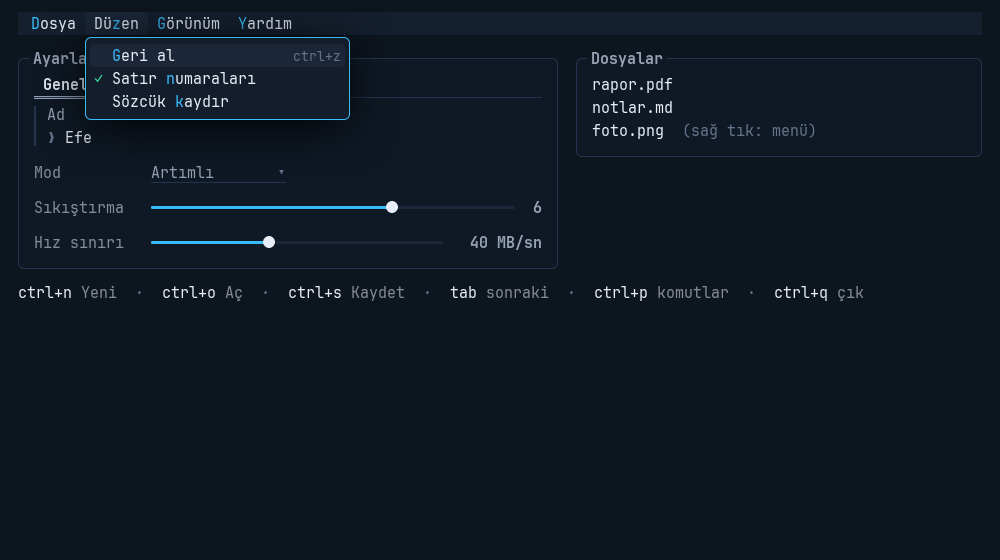

# termik

CLI'ın görünüşü ve hissi, GUI'ın kullanım rahatlığıyla: pygame-ce üzerinde çalışan bir Python arayüz
kütüphanesi.

[](https://pypi.org/project/termik/)
[](https://pypi.org/project/termik/)
[](https://github.com/Efebagci/termik/blob/main/LICENSE)


## Kurulum

```bash
pip install termik
termik demo        # çok panelli örnek uygulama
termik akis        # script'e pencere: akış API'si örneği
```

Python 3.11 ya da daha yenisi gerekir; pygame-ce kendiliğinden kurulur.

## İki katman

**Akış API'si** script'ler içindir: `input()` ve `print()` kadar kısa. Pencere açılamazsa aynı script
terminalde çalışır.

```python
import termik

ad = termik.ask("Adın?")
mod = termik.choose("Mod", ["Tam", "Artımlı"])
if termik.confirm(f"{mod} yedek alınsın mı?"):
    for dosya in termik.track(dosyalar, "Kopyalanıyor", unit="dosya"):
        kopyala(dosya)
termik.ok(f"Bitti, [bold]{ad}[/]!")
```

**Bileşen katmanı** çok panelli uygulamalar içindir: ağaç, flex yerleşim, odak, kısayollar, komut
paleti, menüler, diyaloglar, birden çok pencere ve 30'u aşkın bileşen.

```python
import termik as ui

class Merhaba(ui.App):
    ad = ui.reactive("")

    def compose(self):
        with ui.Form():
            yield ui.Input(label="Adın", bind="ad")
        yield ui.Button("Selamla", self.selamla, key="f5", variant="primary")
        yield ui.KeyBar()

    def selamla(self):
        self.notify(f"Merhaba {ui.escape(self.ad)}!", "ok")

Merhaba().run()
```

## Sayfalar

- **[Bileşen galerisi](bilesenler.md)**: her bileşenin görüntüsü ve onu üreten kod.
- **[Tarifler](tarifler.md)**: ayar formu, canlı grafik, uzun iş, dosya seçme ve bırakma, ikinci
  pencere, sınıfsız araç, testler.
- **[Başvuru (README)](https://github.com/Efebagci/termik#readme)**: bütün kavramlar, seçenekler,
  görünüm belirteçleri ve ayarlar.

## Yeni bir proje

```bash
termik yeni yedekci                      # formlu, kısayollu bir uygulama ve testi
termik çalıştır yedekci/yedekci.py --izle  # kaydettikçe pencere yeniden açılır
```


