# Bileşen galerisi

Her görüntünün altındaki kod onu üreten kodun kendisidir (`compose()` içinde). Sayfa 
`python docs/galeri.py` ile yeniden üretilir.

- [Static, Label](#yazi)
- [Button](#buton)
- [Form, Input, Select, Slider, Spinbox](#form)
- [Checkbox, RadioSet](#secim)
- [OptionList](#liste)
- [TextArea](#textarea)
- [Tabs, Tab](#sekme)
- [Panel](#panel)
- [ProgressBar, Sparkline](#ilerleme)
- [Table](#tablo)
- [Tree, DirectoryTree](#agac)
- [Log](#gunluk)
- [Image](#resim)
- [Chart](#grafik)
- [Canvas](#canvas)
- [Split](#split)
- [MenuBar, Menu](#menu)
- [Header, KeyBar, StatusBar](#cubuklar)

<a id="yazi"></a>

## Static, Label

Markup yazı. `Static` genişliğe göre satır kaydırır, `Label` tek satırda kalıp `…` ile kısalır.

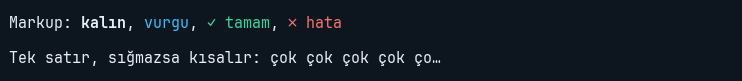

```python
yield ui.Static("Markup: [bold]kalın[/], [accent]vurgu[/], [green]✓ tamam[/], [red]✗ hata[/]")
yield ui.Label("Tek satır, sığmazsa kısalır: " + "çok " * 20, width=48)
```

<a id="buton"></a>

## Button

İkinci argüman fonksiyon ya da eylem adı; `key=` kısayolu ekranın her yerinde çalışır ve kısayol satırında görünür.

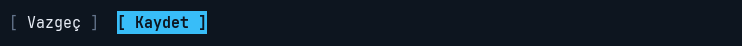

```python
with ui.Row(gap=2):
    yield ui.Button("Vazgeç", "app.quit")
    yield ui.Button("Kaydet", kaydet, key="ctrl+s", variant="primary")
```

<a id="form"></a>

## Form, Input, Select, Slider, Spinbox

Form etiketleri solda hizalı bir sütunda çizer; `bind=` alanı uygulamanın özniteliğine bağlar.

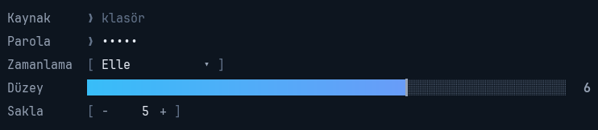

```python
with ui.Form():
    yield ui.Input(label="Kaynak", bind="kaynak", placeholder="klasör")
    yield ui.Input("gizli", label="Parola", password=True)
    yield ui.Select(["Elle", "Her gün 22:00", "Her hafta"], label="Zamanlama")
    yield ui.Slider(6, max=9, label="Düzey")
    yield ui.Spinbox(5, min=1, max=50, label="Sakla")
```

<a id="secim"></a>

## Checkbox, RadioSet

Onay kutusu ve tek seçimli grup; Space, ←/→ ve tıkla değişir.

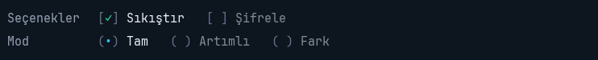

```python
with ui.Form():
    with ui.Row(label="Seçenekler", gap=2):
        yield ui.Checkbox("Sıkıştır", True)
        yield ui.Checkbox("Şifrele")
    yield ui.RadioSet("Tam", "Artımlı", "Fark", label="Mod")
```

<a id="liste"></a>

## OptionList

Yazdıkça bulanık süzülen seçenek listesi; `multi=True` ile çoklu seçim.

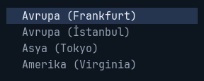

```python
yield ui.OptionList(["Avrupa (Frankfurt)", "Avrupa (İstanbul)", "Asya (Tokyo)", "Amerika (Virginia)"], rows=4)
```

<a id="textarea"></a>

## TextArea

Çok satırlı yazı: seçim, pano, geri al, satır numaraları.

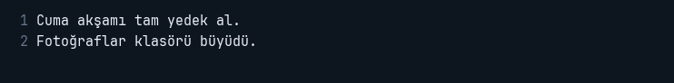

```python
yield ui.TextArea("Cuma akşamı tam yedek al.\nFotoğraflar klasörü büyüdü.", line_numbers=True, rows=3)
```

<a id="sekme"></a>

## Tabs, Tab

Sekmeli kapsayıcı; ctrl+tab ya da başlığa tık.

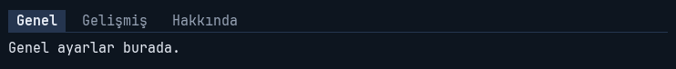

```python
with ui.Tabs():
    with ui.Tab("Genel"):
        yield ui.Static("Genel ayarlar burada.")
    with ui.Tab("Gelişmiş"):
        yield ui.Static("…")
    with ui.Tab("Hakkında"):
        yield ui.Static("termik")
```

<a id="panel"></a>

## Panel

Başlıklı çerçeve; içindekileri alt alta dizer, odak içindeyken çerçevesi yanar.

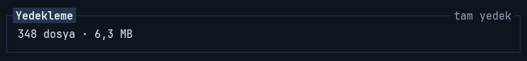

```python
with ui.Panel(title="Yedekleme", info="tam yedek"):
    yield ui.Static("348 dosya · 6,3 MB")
```

<a id="ilerleme"></a>

## ProgressBar, Sparkline

İlerleme çubuğu ve akan değerler için mini grafik.

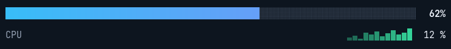

```python
yield ui.ProgressBar(0.62)
yield ui.Sparkline([3, 5, 2, 8, 6, 9, 4, 7, 10, 6, 8, 12], label="CPU", value_format="{:.0f} %")
```

<a id="tablo"></a>

## Table

Sabit başlıklı tablo; başlığa tıklayınca sıralar.

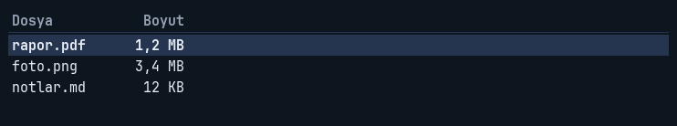

```python
tablo = ui.Table("Dosya", ("Boyut", 10, "right"), height=5)
tablo.add_row("rapor.pdf", "1,2 MB")
tablo.add_row("foto.png", "3,4 MB")
tablo.add_row("notlar.md", "12 KB")
yield tablo
```

<a id="agac"></a>

## Tree, DirectoryTree

Açılır kapanır ağaç; klasör ağacı alt klasörleri ilk açılışta okur.

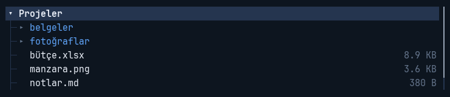

```python
yield ui.DirectoryTree(".", height=6)
```

<a id="gunluk"></a>

## Log

Kayan kayıt: info, ok, warn, error; saat damgası.

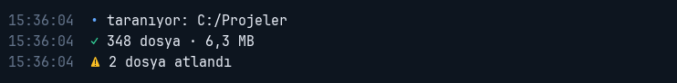

```python
log = ui.Log(timestamps=True, height=3)
log.info("taranıyor: C:/Projeler")
log.ok("348 dosya · 6,3 MB")
log.warn("2 dosya atlandı")
yield log
```

<a id="resim"></a>

## Image

Resim (dosya ya da Surface); kutuya oranı korunarak sığar.

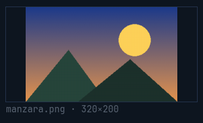

```python
yield ui.Image("manzara.png", height=8, caption="manzara.png · 320×200")
```

<a id="grafik"></a>

## Chart

Çizgi, alan ve çubuk grafiği; canlı veri için `append`.

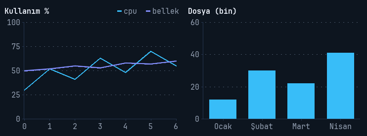

```python
with ui.Row(gap=2, height=11):
    yield ui.Chart({"cpu": [30, 52, 41, 63, 48, 70, 55], "bellek": [50, 52, 55, 53, 58, 57, 60]},
                   title="Kullanım %", y_min=0, y_max=100)
    yield ui.Chart({"Ocak": 12, "Şubat": 30, "Mart": 22, "Nisan": 41}, kind="bar", title="Dosya (bin)")
```

<a id="canvas"></a>

## Canvas

Serbest çizim; çağrılar saklanır, birim karakter ve satır.

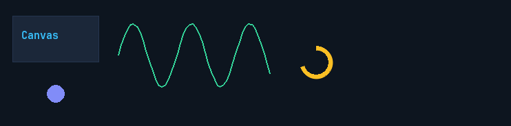

```python
c = ui.Canvas(height=7)
c.rect(1, 0.5, 14, 3, fill="raised", color="border")
c.text(2.5, 1.3, "[bold accent]Canvas[/]")
c.lines([(18 + i / 2, 3 - 2 * math.sin(i / 3)) for i in range(50)], color="green", width=2)
c.circle(8, 5.5, 1.4, fill="accent2")
c.arc(50, 3.5, 2.6, 90 - 360 * 0.7, 90, color="yellow", width=5)
yield c
```

<a id="split"></a>

## Split

Bölünebilir kapsayıcı; ayraç fareyle sürüklenir, oranlar korunur.

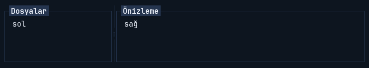

```python
with ui.Split(sizes=[24, "1fr"], height=5):
    yield ui.Panel(ui.Static("sol"), title="Dosyalar")
    yield ui.Panel(ui.Static("sağ"), title="Önizleme")
```

<a id="menu"></a>

## MenuBar, Menu

Menü çubuğu: Alt+harf ya da F10 açar.

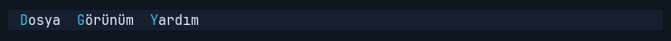

```python
yield ui.MenuBar(ui.Menu("&Dosya", [ui.MenuItem("&Kaydet", kaydet, key="ctrl+s")]),
                 ui.Menu("&Görünüm", []), ui.Menu("&Yardım", []))
```

<a id="cubuklar"></a>

## Header, KeyBar, StatusBar

Başlık, geçerli kısayollar ve durum çubuğu.

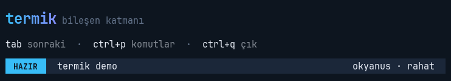

```python
yield ui.Header("termik", "bileşen katmanı", clock=False)
yield ui.KeyBar()
yield ui.StatusBar(mode="HAZIR", left="termik demo", right="okyanus · rahat")
```

Bütün bileşenler, seçenekleri ve kavramlar için [başvuru (README)](https://github.com/Efebagci/termik#readme).
